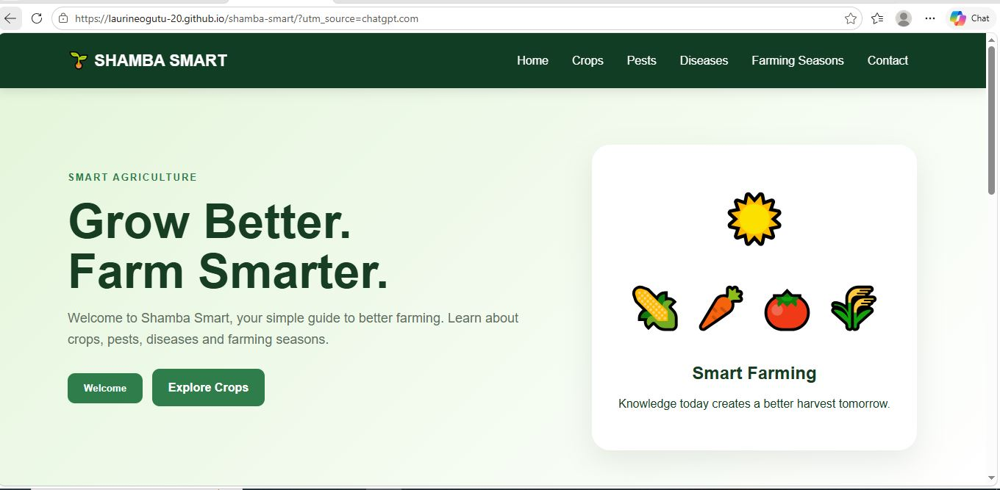
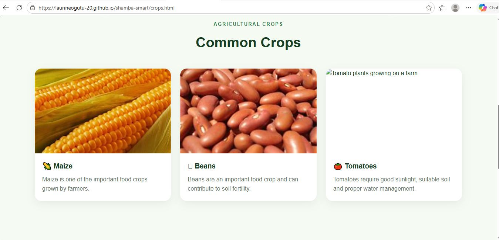
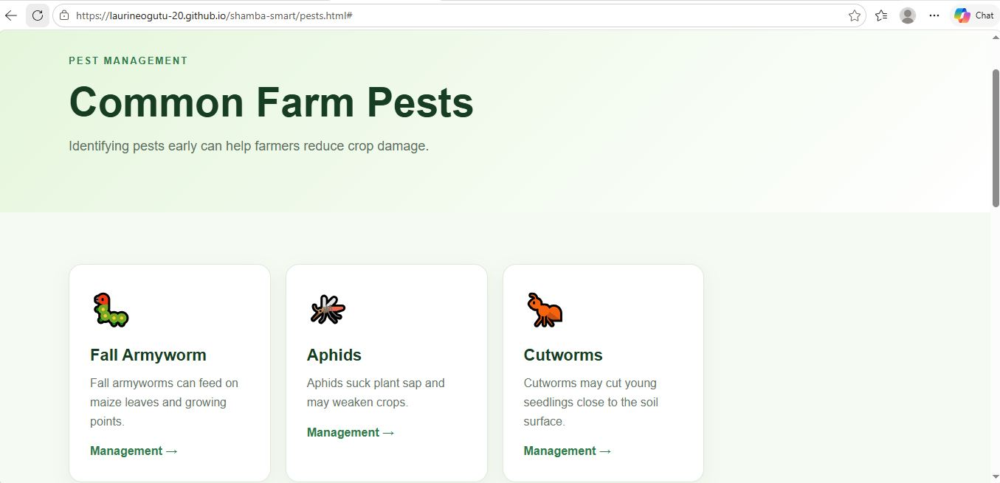
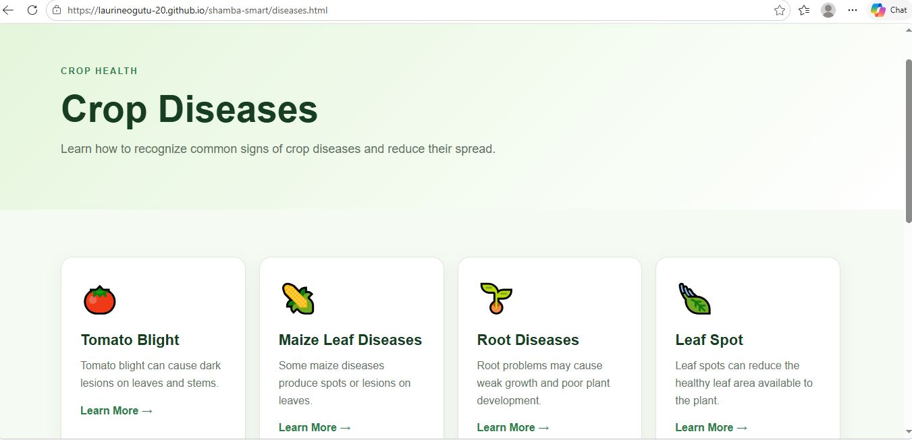
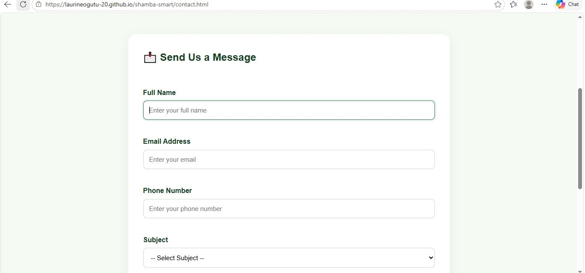

# 🌱 Shamba Smart – Agricultural Information Website

**Shamba Smart** is a beginner-friendly agricultural information website designed to help farmers and other users access useful information about crops, pests, plant diseases, and farming seasons. It also provides a contact page for enquiries.

🌐 **Live Website:** [Visit Shamba Smart](https://laurineogutu-20.github.io/shamba-smart/)

👩‍💻 **Developer:** [Laurine Abong'o Ogutu](https://github.com/LaurineOgutu-20)

---

## 📌 Project Overview

Shamba Smart is a web development project focused on making agricultural information accessible through a simple, organised, and user-friendly website.

The project demonstrates fundamental front-end web development skills using HTML, CSS, and JavaScript.

## ✨ Features

- 🏠 **Homepage:** Introduces the Shamba Smart website.
- 🌱 **Crops Information:** Provides agricultural crop information.
- 🐛 **Pest Information:** Helps users learn about agricultural pests.
- 🦠 **Plant Diseases:** Provides information about plant diseases.
- 🌦️ **Farming Seasons:** Presents information about farming seasons.
- 📩 **Contact Page:** Provides a contact form for user enquiries.
- ✅ **Form Validation:** Uses JavaScript to validate contact form inputs.
- 📱 **Responsive Styling:** CSS styling helps the website adapt to different screen sizes.

## 🛠️ Technologies Used

- **HTML5** – Website structure and content.
- **CSS3** – Styling and page layout.
- **JavaScript** – Interactive features and form validation.
- **Git** – Version control.
- **GitHub** – Source code hosting.
- **GitHub Pages** – Website deployment.

## 📸 Website Screenshots

### 🏠 Homepage



### 🌱 Crops Page



### 🐛 Pests Page



### 🦠 Diseases Page



### 📩 Contact Page



## 📂 Project Structure

```text
Shamba Smart/
├── index.html
├── crops.html
├── pests.html
├── diseases.html
├── seasons.html
├── contact.html
├── style.css
├── script.js
├── README.md
└── images/
    ├── Homepage.JPG
    ├── CROPS.JPG
    ├── PESTS.JPG
    ├── DISEASES.JPG
    ├── CONTACT.JPG
    ├── beans.jpg
    ├── maize.jpg
    ├── potatoes.jpg
    └── tomatoes.jpg
```

## 🚀 How to Run the Project Locally

1. Clone this repository:

   ```bash
   git clone https://github.com/LaurineOgutu-20/shamba-smart.git
   ```

2. Open the downloaded project folder.
3. Open `index.html` in a web browser.
4. Navigate through the website using the available menu links.

You can also open the project folder in Visual Studio Code and use a local development extension such as Live Server.

## 🌐 Live Demo

Explore the published website:

**[https://laurineogutu-20.github.io/shamba-smart/](https://laurineogutu-20.github.io/shamba-smart/)**

## 🎯 Project Objectives

- Practise HTML, CSS, and JavaScript.
- Build a multi-page website with consistent navigation.
- Apply JavaScript form validation.
- Learn Git version control and GitHub repository management.
- Deploy a website using GitHub Pages.
- Present a practical web development project in a developer portfolio.

## 👩‍💻 About the Developer

**Laurine Abong'o Ogutu**

ICT Technician student at Masai Technical Training Institute, developing practical skills in web development, programming, and information technology.

This project is part of my practical learning journey and demonstrates my commitment to building and publishing useful digital solutions.

- **GitHub Profile:** [LaurineOgutu-20](https://github.com/LaurineOgutu-20)
- **Project Repository:** [Shamba Smart on GitHub](https://github.com/LaurineOgutu-20/shamba-smart)
- **Live Website:** [Shamba Smart](https://laurineogutu-20.github.io/shamba-smart/)

## 📄 License

This project is available for learning and demonstration purposes. No formal open-source license has been specified.

---

**Thank you for visiting Shamba Smart! 🌱**

